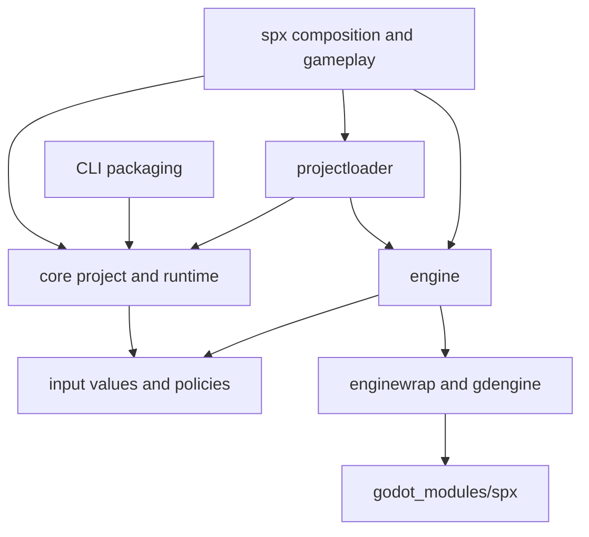

## Architecture

### 0. Overall architecture

SPX consists of the XGo game runtime, platform bindings, and the SPX fork of Godot. Game logic is written in XGo/SPX, while rendering, audio, input, physics, and platform integration are provided by the engine.

The Go-to-engine boundary differs by platform. Native platforms use GDExtension/native bindings. Web builds combine Go WASM with an Emscripten-built Godot runtime and JavaScript bridge code.

Unhandled coroutine panics reach the engine as `coroutine.PanicReport`, preserving the original value, thread name, and stack at the fault. The engine includes this context in its log and `OnRuntimePanic` callback; an optional creation stack is labeled separately. `ErrAbortThread` and `ErrStopThisScript` remain normal control flow and are not reported. Shutdown barriers wait for panic reporting to finish, and lifecycle cleanup still runs if the reporter panics.

### Responsibilities and dependency direction

| Layer | Responsibility | Boundary |
| --- | --- | --- |
| Root `spx` package | Public game/sprite API, composition, script and frame orchestration | Owns live game objects and engine proxies |
| `internal/core/project` | Configuration, packed overlays, fonts and display plans | Consumes resource capabilities; does not select an engine |
| `internal/core/runtime`, `internal/input` | Input normalization, replay values and script-loop rules | Operates on values and supplied callbacks/clocks |
| `internal/projectloader` | Runtime resource assembly | Adapts engine resources before core configuration loading |
| `internal/engine` | Engine lifecycle, coordinate adaptation and frame synchronization | Uses typed manager wrappers |
| `internal/enginewrap`, `internal/gdengine` | Main-thread calls, native/Web transport and callbacks | Generated bindings implement the declared ABI |
| `godot_modules/spx` | Engine-side implementation and exported manager declarations | Owned by SPX; built with the separate Godot checkout |
| CLI path and project preparation | Resolve source/generated directories and prepare project inputs | Explicit command directories and returned preparation errors |

Configuration parsing receives a resource directory once. The runtime loader places engine lookup **below** the packed configuration overlay, so later sprite, sound and tilemap reads use the same directory and precedence rules. Preparation resolves assets from that directory without consulting the previous game's global asset root. Font discovery and binary availability are optional directory capabilities: a Web interpreter can verify a font mounted in Godot without reading its binary through the interpreter filesystem. Neither core parsing nor offline packaging should need a running engine or a global backend registration hook.

Input events belong to `internal/input`; `internal/engine` keeps aliases for its callers. This avoids conversion copies and lets input policy tests run without engine initialization. The public named key-code API remains compatible.

The root package is intentionally the composition layer. Public overloads, reflection-based XGo objects and generated interpreter exports constrain package boundaries. Move reusable policy into core packages; keep an engine-bound, single-consumer implementation beside its owner. A file split alone does not create a useful architectural boundary.

### Preparation and effects

Binding generation prepares headers and parses the source ABI in memory, renders and formats all targets into one output plan, then publishes the plan. It does not use the checked-in ABI header as temporary storage. Rendering or validation failure leaves published output unchanged. Publication is not a multi-file filesystem transaction: an I/O failure during commit can still leave a partially written set. See [code generation](./code_generator.md).

CLI path resolution does not change process cwd. Commands receive their source or generated-project directory explicitly. Project preparation returns errors to command orchestration and cleans up temporary source after dependency resolution. Tests and command paths can reuse preparation without changing the caller's cwd. Legacy execution helpers still contain `Fatalf`, and command dispatch still sets `GODEBUG`; those broader process effects have not been migrated.

### Project load plan

After opening resources and parsing command-line flags, `game_load.go` coordinates a `projectPlan` prepared in `game_prepare.go` and applied by `game_apply.go`. `game_stage_entries.go` handles stage entry preparation and application. Preparation processes project constraints, sprite fields, tilemap, and stage entries in that order. Each stage entry immediately prepares its required prototype so a later syntax error cannot hide an earlier configuration read error. Application reuses the Go parsing results without rereading sprite and stage configurations.

Field preparation allocates pointers and interfaces only on a temporary game value. Stage plans retain direct field indices and property values, then bind the corresponding live fields during application without repeating name lookup. A failure during plan preparation publishes no sprite fields, prototypes or shapes, applies no fonts and allocates no engine objects. Empty groups do not read prototypes; failed monitor bindings are skipped, and BGM or optional decorator failures remain nonfatal.

Application follows this order: fonts and runtime/physics settings → sprite proxies → prepared tilemap data → display and camera → tilemap geometry, decorators and audio → stage instances → queued bootstrap work. New-format tilemaps are submitted to the Godot path API when their prepared data is installed; Godot rereads their files. BGM remains lazily loaded, so the plan is not an immutable snapshot of all assets. Backend failures during application can leave partial state; the plan does not provide full engine rollback.

### Runtime assets and sprite layouts

CLI and `launchpack` share the `RuntimeNames` naming contract and complete-set `Assets.ValidateFiles` checks. Interpreted execution selects Engine, adjacent PCK and bridge for the actual host. Legacy installation search prefers embedded assets, then GOPATH/bin and the executable directory, accepting the first complete directory without mixing files across directories. Source mode may build its bridge in a separate directory; published and explicit-manifest acquisition retain their version, hash and use-lease checks.

Historical installations have no bridge-version metadata. Co-location and selected file names do not prove binary version identity. An incomplete directory may fall through to a later complete one; mismatched Engine/PCK version names and wrong-platform bridge names are rejected. Legacy CLI now also requires regular non-symlink files; installations assembled with file symlinks are no longer accepted.

`spriteLayout` records each type's first direct SpriteImpl field, generated owner slot, `InitFrom` calls and user fields. Clone hook signatures are checked only for actual cloning or nonempty stage groups, so they do not constrain sprites that are never cloned. Loading validates the owner before zeroing storage; lookup and cloning share the layout. Handwritten sprites may move the direct base field, while existing shallow-reference and List `InitFrom` behavior is preserved. `core/project.WritableField` centralizes access to unexported generated fields without changing public SPX APIs or interpreter-visible signatures.

### Verification boundaries

Dependency checks for `./internal/core/project` and `./cmd/spx/internal/pack` must exclude `internal/engine` and `internal/gdengine`, keeping core parsing and offline packaging independent of the engine backend.

Test core rules and engine adapters separately. Run the root and interpreter suites, and test the nested `internal/cmd/codegen` module independently. Changes to ABI declarations or engine-side behavior also require building the affected native/Web targets.

### 1. PC platforms

Desktop builds support two primary workflows:

- interpreted development through `spx run`;
- native runtime execution through `spx runnative`, editor execution, or exported desktop packages.

SPX communicates with Godot through generated native bindings. Runtime assets and the matching engine binary must be installed before native execution.

### 2. Web platform

Web builds contain a Go WASM module, a Godot Web export, and JavaScript glue. SPX supports four modes: `normal`, `worker`, `minigame`, and `miniprogram`. The same mode must be used while preparing, building, and exporting assets.

Normal mode runs the host integration on the browser main thread. Worker mode moves the engine workload to a worker and uses message-based bridges where direct browser access is unavailable. Mini-game and mini-program modes add platform-specific adapters.

### 3. Android platform

Android exports use the Godot Android template together with the SPX runtime and generated bindings. Building from source requires the Android SDK, NDK, JDK, and the SPX Godot fork.

### 4. iOS platform

iOS exports use the Godot iOS template and SPX runtime. Local exports require the Apple toolchain and signing configuration. The build orchestration prepares the required engine artifacts before the project export step.
