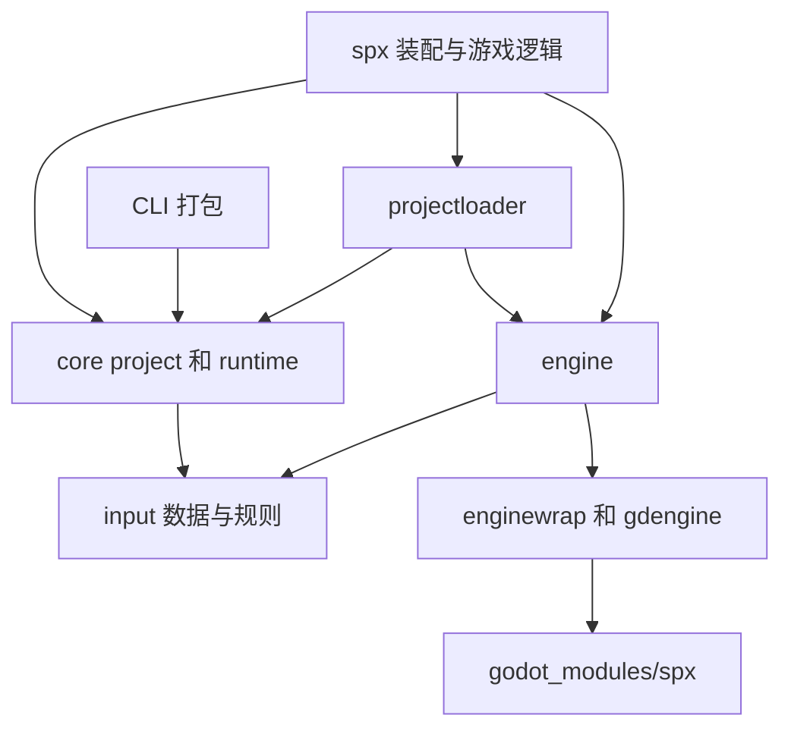

## 架构设计

### 0. 整体架构

SPX 包含 XGo 游戏运行时、平台绑定和 SPX 使用的 Godot 分支。游戏逻辑由 XGo/SPX 表达，渲染、音频、输入、物理和平台集成由引擎提供。

Go 到引擎的边界随平台变化：原生平台通过 GDExtension/native 绑定调用引擎；Web 通过 JavaScript 连接 Go WASM 与 Emscripten 编译的 Godot。

协程未处理的 panic 通过 `coroutine.PanicReport` 传递到引擎，保留原始值、线程名和故障位置的栈。引擎日志和 `OnRuntimePanic` 回调包含这些信息，可选的创建栈单独标注。`ErrAbortThread` 和 `ErrStopThisScript` 仍作为正常控制流，不报告为错误。关闭屏障会等待 panic 报告结束；即使报告处理器发生 panic，生命周期清理也仍会执行。

### 职责与依赖方向

| 层 | 职责 | 边界 |
| --- | --- | --- |
| 根 `spx` 包 | 游戏/精灵公开接口、对象装配、脚本与帧调度 | 持有游戏对象和引擎代理 |
| `internal/core/project` | 配置、打包配置覆盖、字体和显示方案 | 消费资源能力，不选择引擎 |
| `internal/core/runtime`、`internal/input` | 输入归一化、回放数据和脚本循环规则 | 处理值，通过参数接收回调和时钟 |
| `internal/projectloader` | 运行时资源装配 | 先适配引擎资源，再交给核心配置层 |
| `internal/engine` | 引擎生命周期、坐标转换、帧同步 | 使用有类型的 manager 包装 |
| `internal/enginewrap`、`internal/gdengine` | 主线程调用、原生/Web 传输、回调 | 生成绑定实现声明的 ABI |
| `godot_modules/spx` | 引擎侧实现与导出的 manager 声明 | 由 SPX 仓库持有，与独立 Godot 仓库一起构建 |
| CLI 路径与项目准备 | 解析源码/生成项目目录，准备项目输入 | 显式指定命令目录，返回准备错误 |

配置解析只接收一次资源目录。运行时加载器把引擎查找放在打包配置覆盖层的**下方**，后续精灵、声音和瓦片地图都沿用同一目录与优先级。准备阶段根据该目录定位资源，不依赖上一个游戏的全局资源根目录。字体目录发现和二进制存在性检查是可选目录能力：Web 解释器可以验证 Godot 挂载的字体，而不必从解释器文件系统读取字体二进制。核心解析和离线打包不应要求启动引擎，也不需要全局后端注册钩子。

输入事件归属 `internal/input`，`internal/engine` 为既有调用方保留类型别名。这样不需要转换或复制事件切片，输入规则测试也无需初始化引擎。公开的具名键码类型保持兼容。

根包有意承担装配职责。公开重载、基于反射的 XGo 对象和生成的解释器导出共同约束包边界。可复用规则进入核心包；依赖引擎且只有一个使用方的实现留在所属对象附近。仅拆分文件并不能形成有价值的架构边界。

### 准备阶段与副作用

绑定生成先在内存中准备头文件、解析源 ABI，把所有平台产物渲染并格式化到同一个输出计划，最后统一写入。正式 ABI 头不再承担临时存储职责。渲染或校验失败不会改动已发布产物。写入阶段不是跨文件事务：提交时发生磁盘 I/O 错误仍可能留下部分写入。详见[代码生成](./code_generator.md)。

CLI 路径解析不改变进程工作目录；每条命令显式接收源码目录或生成项目目录。项目准备向命令编排层返回错误，并在依赖解析后清理临时源码。测试和不同命令入口可以复用准备过程而不改变调用者 cwd。遗留执行工具仍有 `Fatalf`，命令派发仍设置 `GODEBUG`，这些更广泛的进程副作用尚未迁移。

### 项目加载计划

资源目录打开、命令行参数解析后，`game_load.go` 编排 `projectPlan` 的加载过程，`game_prepare.go` 准备计划，`game_apply.go` 应用计划；`game_stage_entries.go` 负责舞台条目的准备与应用。准备阶段依次处理项目约束、字段精灵、瓦片地图和舞台条目。每个舞台条目立即准备其依赖的原型，避免后面的语法错误遮蔽前面的配置读取错误。Go 解析结果在本次加载中复用，应用阶段不再重新读取精灵和舞台配置。

字段准备只在临时游戏值上分配指针和接口，舞台计划保存直接字段索引和属性值，应用时绑定对应的实际游戏字段，不再重复按名称查找。计划准备阶段失败时，不会发布精灵字段、原型和舞台对象，也不会应用字体或分配引擎对象。空精灵组不读取原型；monitor 绑定失败会跳过，BGM 失败和可选 decorator 失败仍保持容错。

应用阶段依次执行：字体与运行设置/physics → 精灵代理 → 已准备的 tilemap 数据 → 显示与相机 → tilemap 几何、decorator 和音频 → 舞台实例 → bootstrap 入队。新格式 tilemap 在接收准备数据时提交给 Godot 路径接口，由 Godot 再次读取文件。BGM 仍为懒加载，因此计划不是全部资产的不可变快照。应用阶段的后端失败可能留下部分状态，计划不提供完整的引擎回滚。

### 运行时资产与精灵布局

CLI 与 `launchpack` 使用同一个 `RuntimeNames` 命名契约和 `Assets.ValidateFiles` 完整集合检查。解释运行按实际 host 选择 Engine、相邻 PCK 和 bridge；旧安装路径依次检查嵌入资源、GOPATH/bin、可执行文件目录，选择第一个完整目录，禁止跨目录拼装。源码模式允许 bridge 来自独立构建目录；发布包和显式 manifest 仍保留原有版本、hash 与资源使用租约校验。

旧安装目录没有 bridge 版本元数据，只能断言同目录与选定文件名，不能将其称为已验证的二进制版本一致性。缺少组件的目录可继续向后查找；混合版本的 Engine/PCK 文件名和错误平台 bridge 会被拒绝。旧 CLI 现在也使用普通非符号链接文件检查，不再接受用文件符号链接拼装的安装。

`spriteLayout` 按类型集中记录首个直接 SpriteImpl 字段、生成代码的 owner 槽位、`InitFrom` 调用及用户字段。克隆 hook 的签名只在实际克隆或非空舞台组准备时约束，不影响无需克隆的普通精灵。加载在清零之前验证 owner，查找和克隆复用同一布局；手写精灵可以调整直接基类字段位置，现有浅引用与 List 的 `InitFrom` 行为不变。`core/project.WritableField` 收口对生成器非导出字段的访问，公开 SPX 接口与解释器可见签名不变。

### 验证边界

`./internal/core/project` 与 `./cmd/spx/internal/pack` 的依赖检查应排除 `internal/engine` 和 `internal/gdengine`，确保核心解析和离线打包不依赖引擎后端。

分别测试核心规则和引擎适配器行为，运行根模块与解释器测试，并单独测试 `internal/cmd/codegen` 嵌套模块。修改 ABI 声明或引擎侧行为时，还需构建受影响的原生/Web 目标。

### 1. PC 平台

桌面端支持两条主要路径：

- 通过 `spx run` 进行解释执行开发；
- 通过 `spx runnative`、编辑器或导出的桌面包执行原生运行时。

SPX 使用生成的原生绑定与 Godot 通信。原生执行前需要安装匹配的运行时资源和引擎二进制。

### 2. Web 平台

Web 产物由 Go WASM、Godot Web 导出和 JavaScript 桥接组成。支持 `normal`、`worker`、`minigame`、`miniprogram` 四种模式，准备、构建和导出时应使用相同模式。

普通模式在浏览器主线程运行宿主集成；worker 模式把引擎放到 worker 中，通过消息处理不能直接访问的浏览器能力。小游戏和小程序模式提供各自的平台适配。

### 3. Android 平台

Android 导出将 Godot Android 模板与 SPX 运行时、生成绑定组合。从源码构建需要 Android SDK、NDK、JDK 和 SPX 使用的 Godot 分支。

### 4. iOS 平台

iOS 导出使用 Godot iOS 模板和 SPX 运行时。本地导出需要 Apple 工具链及签名配置；构建编排会在项目导出前准备所需引擎产物。
